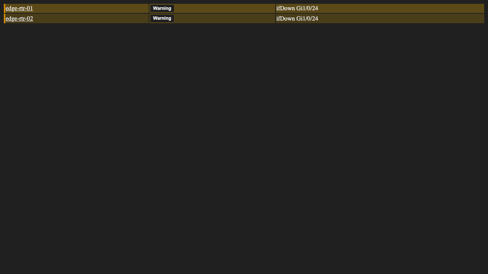

# syslog

Syslog collects and searches log messages inside Cacti, applies alert and removal
rules, and sends notifications or runs configured commands when rules match.
It can also consume SNMP traps and informs forwarded as Syslog messages by SNMPTT.

Incoming program names have leading and trailing parentheses and square brackets
removed before reference lookup and rule processing. Interior punctuation is
preserved. This normalization does not rename programs in existing archived logs.

For log events that continue to be generated frequently on a device, such as
smartd's feature to notify every 15 minutes of an impending drive failure, can
be quieted using syslog's 'Re-Alert' setting.

Threshold rules count matching messages within their rolling window. **Recover
After Quiet Period** defaults to 5 minutes: each match during an active breach
restarts that timer. A complete quiet period clears the breach, resets its count
to zero, and rearms it. The initial alert is sent once per breach; the existing
Re-Alert setting controls subsequent notifications while it remains active.

The **Breached Thresholds** tab appears when enabled threshold rules exist and
lists active breaches by rule and device, independently of notification history.

The Messages view shows **Breach = Yes** for messages associated with an active
breach and **No** after recovery. Grouped rows show Yes if any member is associated
with an active breach. Recovery updates indexed state and message associations,
without scanning or updating historical message rows. Existing historical flags
are not converted into active breaches. See [threshold recovery](docs/THRESHOLD_RECOVERY.md)
for lifecycle and deployment details.

## Versions and compatibility

This README describes the `develop` source branch.

| Code | Plugin version | Minimum Cacti declared in `INFO` |
| --- | --- | --- |
| [Source branch](https://github.com/Cacti/plugin_syslog/blob/develop/INFO) | 5.0 | 1.2.23 |
| [Published v4.2](https://github.com/Cacti/plugin_syslog/releases/tag/v4.2) | 4.2 | 1.2.23 |

Use the published release’s assets and tagged documentation when installing that
package. Branch code can include later changes, even when its version number
matches the release. Cacti’s own PHP and database requirements also apply.

Install this plugin in **`<cacti-root>/plugins/syslog`**, using the directory
name `syslog` rather than `plugin_syslog`.

See [CHANGELOG.md](https://github.com/Cacti/plugin_syslog/blob/develop/CHANGELOG.md) for the version history.

[All published release notes](https://github.com/Cacti/plugin_syslog/blob/develop/docs/RELEASE_HISTORY.md)

[Version 5.0 release notes and upgrade guidance](https://github.com/Cacti/plugin_syslog/blob/develop/docs/RELEASE_NOTES_5.0.md) · [Contributors and change history](https://github.com/Cacti/plugin_syslog/blob/develop/docs/COMMITS_5.0.md)

[Setup module ownership](https://github.com/Cacti/plugin_syslog/blob/develop/docs/setup-modules.md) describes how `setup.php` and the `includes/` modules divide the plugin code.

## Core Features

* Message filtering

* Message searching

* Dashboards with time series and breakdown charts of your saved searches

* Share dashboards with all syslog users and manage every dashboard as an
  administrator

* Message Alerting

* Alert Reporting Levels of System and Device

* Alert Methods of Individual and Threshold Based

* Message Removal Rules that either Delete messages or Transfer them to the
  `syslog_removed` table

* Filter Messages by Cacti Graph window from Cacti's Graph View pages

* Use of native MySQL and MariaDB database partitioning for larger installs

* Remote Log Server connection capabilities

* Custom column mappings between Remote Log Server and required Syslog columns

* Ability to Generate Tickets to Ticketing Systems through Script Execution

* Ability to run alert specific commands at Alert and Re-alert times

* Recommendations: a lightbulb marks messages with an explanation and a recommended
  action from a vendor-neutral knowledge base that you can edit, import, and
  export (see Recommendations below)

## Pipeline Health Alerts

The Status tab includes a **Pipeline health** card in the existing Collector
health card position. It reports stalled processing, excessive or old incoming
backlogs, failed or delayed remote synchronization, and blocked partition
maintenance. An empty incoming queue is healthy when processing is completing;
quiet devices do not trigger source-silence alerts. Unavailable queue metrics
are reported as problems rather than healthy values.

Checks run from Cacti's poller before launching the Syslog processor, so a
stalled processor can still be detected. The delay is the greater of the
Collector Staleness Threshold, three poller intervals, and 300 seconds. New or
re-enabled monitoring gets a startup grace period. Incoming age uses the
configured incoming timestamp field; delayed historical events or incorrect
source clocks can therefore trigger an old-backlog warning.

In **Settings > Syslog**, select a **Pipeline Health Notification List** from
Thold and/or set **Pipeline Health Email Recipients** to enable problem,
changed-problem, reminder, and recovery emails using Cacti's mail settings.
Enabled lists add their current recipients on each check, preserving BCC
recipients; disabled or missing lists contribute no addresses. Direct email
recipients work without Thold. Email is disabled by default. Persistent problems repeat at the
configured reminder interval, and failed delivery attempts retry no more than
once every five minutes. The card shows the last health check, email attempt
status, and last successful send. Health state changes also appear in Cacti's
log. Intentionally disabled processing does not generate health notifications.

Monitoring requires a running Cacti poller and an accessible Syslog database.
Use external monitoring for a complete Cacti or database outage. Remote health
checks run on each enabled remote collector; this does not infer a collector
outage merely from a quiet stream of device messages.

## Table Architecture and Storage Engine Support

New installs always create partitioned `syslog` tables.  The traditional
non-partitioned table architecture is deprecated and can no longer be
selected during installation.  Existing installs that still run traditional
tables keep working and receive a notice advising an upgrade to partitioned
tables, but the plugin does not migrate the table automatically.

Only the InnoDB storage engine and, on MariaDB, the Aria storage engine are
supported.  Other engines, including MyISAM, are no longer offered and fall
back to InnoDB when legacy settings request them.  Enabling any Remote Data
Collector option requires InnoDB; the setup advisor selects it automatically.

## Millisecond Timestamps

The `logtime` column can be stored either at second precision (a `TIMESTAMP`
column) or at millisecond precision (a `TIMESTAMP(3)` column).  Millisecond
precision preserves the sub-second ordering of high-rate messages.

**Millisecond precision is only supported on MariaDB.**  MariaDB can still
`RANGE` partition a `TIMESTAMP(3)` column by `UNIX_TIMESTAMP(logtime)` and prune
partitions; MySQL rejects that partition function on a fractional column, so
MySQL installs always use second precision.

### Choosing the precision

* **New installs** – the setup advisor shows a *Timestamp Precision* option.
  On MariaDB it defaults to *Millisecond - TIMESTAMP(3)*; on MySQL it is fixed
  to second precision.  Silent installs can set
  `$syslog_install_options['logtime_precision'] = 'ms';` (or `'sec'`) in
  `config.php` / `config_local.php`; a millisecond request on MySQL is rejected
  with a log message rather than silently downgraded.  The advisor's
  *Partitioning Level* option is set silently with
  `$syslog_install_options['partitioning'] = 'day';` (or `'hour'`); see
  [Partitioning level](#partitioning-level).
* **Upgrades** – the existing schema is authoritative and is **never** migrated
  automatically, even if the configured precision changes.  This avoids the
  long, blocking table rewrite that an in-place precision change would require.
* **Existing production systems** – switch precision only with the CLI utility
  below, during a maintenance window. The unified utility preserves messages
  by default.

### Converting an existing MariaDB install

```console
php plugins/syslog/cli/upgrade_partitioning.php --convert-ms
```

The `--convert-ms` option is **MariaDB only**. It rebuilds the stored/removed
message tables to `TIMESTAMP(3)`, preserving data in verified batches of at
most **50,000 rows**. The incoming queue (`syslog_incoming`) and replication
outbox (`syslog_replication_output`) are widened in place with `ALTER TABLE`,
so their sequence numbers, which archival and replication use as identities,
are unchanged and undelivered rows are never discarded. Already-converted
tables are left alone. Existing second-resolution messages gain `.000`;
conversion cannot recover fractional timestamps that were never recorded.

The default is preservation. The explicit
`--discard-data` option deletes messages in rebuilt
tables. Rules and unrelated settings are not changed. The precision setting
is recorded only after the complete pipeline has converted.

### Rebuilding partition layouts

```console
php plugins/syslog/cli/upgrade_partitioning.php [--partition=hourly|daily]
```

Without `--convert-ms`, this rebuilds `syslog` and `syslog_removed` using the
**Partitioning Level** (`syslog_partition_granularity`), storage engine
(`syslog_install_engine`), message retention (`syslog_retention`) and
future-partition horizon (`syslog_partition_ahead_days`), retaining their
existing timestamp precision. It preserves existing columns and indexes, adds
`logtime` to a legacy sequence-only primary key when necessary, and creates UTC
hourly (`hYYYYMMDDHH`) or daily (`dYYYYMMDD`) `UNIX_TIMESTAMP(logtime)`
partitions with a final `dMaxValue` safety partition. Any existing RANGE
layout, hourly or daily, can be rebuilt to either level.

### Partitioning level

Settings > Syslog > **Data Retention and Partitioning** offers a **Partitioning
Level** of **Daily** (the default) or **Hourly**. Like MacTrack's partition
size, the level is chosen in Settings, or with `--partition=hourly|daily`,
which saves it, and applied by `cli/upgrade_partitioning.php`. Unlike MacTrack,
saving the setting alone changes nothing: poller maintenance keeps creating and
pruning partitions of the size the tables actually have, until the utility
rebuilds them. Settings and the Status tab show the change as pending until then.
There is no Disabled level; partitioned tables are the only supported
architecture.

Hourly tables keep the configured pre-create window, but never less than two
days of hourly partitions ahead (MacTrack also keeps two days), so new
partitions are always split from an empty `dMaxValue` and the reorganization is
instant even when maintenance runs late. While the horizon exists, maintenance
checks only its last partition; a gap is found with a binary search and healed
in bounded steps.

Saving Syslog settings is refused, with an error naming the required and
permitted partition counts, when a table would need more partitions than the
database server supports: retention plus today plus the pre-create window,
times 24 for Hourly, plus `dMaxValue`. The limit is 8192 partitions, or 1024
on MariaDB before 10.0.4 and MySQL before 5.7. Hourly partitioning also
requires a finite retention. For example, Hourly with 183 days of retention
needs 4,489 partitions; with one year it needs 8,857 and is refused. The
installer and the utility apply the same check.

Every message query has an automatic upper bound of the current time, whatever
its filter says, so the empty future partitions are always pruned. Messages
with timestamps in the future, for example from a device with a fast clock,
are not shown until that time.

Stored and removed messages are copied **without** their `seq` column, in their
original order, so each replacement numbers them from its own
`AUTO_INCREMENT`. That counter is set above the original high-water mark before
the first row is copied, so a sequence value is never reused; links that
captured an old `seq` find nothing rather than a different message. All other
columns, including `replication_source_event_id`, are copied unchanged.
Existing `TIMESTAMP` rows are copied in UTC, preserving distinct events across
daylight-saving clock changes.

Legacy `DATETIME` `logtime` columns are **not supported**. A `DATETIME` holds
wall-clock time in an unknown zone; values in a daylight-saving gap do not
exist as `TIMESTAMP` and values in the repeated hour are ambiguous, so no
automatic conversion is safe. The utility refuses to preserve such tables
before changing anything. Either rebuild them with `--discard-data`, or, after
verifying the zone the values were written in, convert them yourself with
Syslog processing stopped. First confirm that every value round-trips in
that zone, then convert and repartition in one statement:

```sql
SET SESSION time_zone = 'America/New_York';  -- the zone the values were written in
SELECT COUNT(*) FROM syslog
  WHERE NOT (FROM_UNIXTIME(UNIX_TIMESTAMP(logtime)) <=> logtime);  -- must be 0
ALTER TABLE syslog MODIFY COLUMN logtime timestamp NOT NULL DEFAULT '0000-00-00 00:00:00'
  PARTITION BY RANGE (UNIX_TIMESTAMP(logtime)) (/* daily partitions */
  PARTITION dMaxValue VALUES LESS THAN MAXVALUE);
```

Then run this utility to apply the configured layout.

Every existing message is copied, including older-than-retention messages;
those older rows fit in the earliest RANGE partition. Normal retention pruning
resumes when processing restarts. Indefinite retention (Daily only) creates
daily partitions back to the oldest valid timestamp, and future-dated messages
extend the planned horizon. Plans exceeding the server's partition limit are
rejected rather than dropping history. Custom triggers, foreign keys, or unique
indexes that exclude `logtime` require a manual migration.

`cli/syslog_schema.php --upgrade` and `--repair` repair and upgrade schema and
create missing tables; they do **not** rebuild an existing partition layout or
change its timestamp precision. Ordinary retention/horizon changes normally
need no rebuild: poller maintenance creates missing hourly or daily partitions,
reorganizes `dMaxValue` safely, and removes expired partitions. Use the explicit
rebuild utility to change the partitioning level, for legacy layouts or engine
changes, not routine rotation.

**Maintenance requirements for both commands:**

* Back up the database and uncheck **Settings > Syslog > Syslog Enabled**. The
  utility refuses to start while processing is enabled or a processing run is
  active, and holds a database lock that `syslog_process.php` also takes, so no
  processing run can start during the rebuild. Neither side ever terminates the
  other. It does **not** stop remote collectors, replication or external database
  writers: stop them and buffer new logs upstream. Keep everything stopped
  until the rebuild or recovery finishes. Live log tables are temporarily absent
  or incomplete; avoid using log views during the rebuild. DDL waits at most
  30 seconds for metadata locks before reporting failure; let active queries
  finish before retrying.
* Before confirmation, the utility reports the **estimated size of the current
  Syslog database, including data and indexes**. Have **at least that much
  additional free disk space on the database server** during transfer, plus
  headroom for temporary files, indexes and binary logs. Database metadata is
  an estimate; the utility cannot verify free space on a remote database server.
* Depending on table size and storage speed, copying and verification can take
  **several hours**. `--confirm` skips the prompt but not these warnings.
* DDL is **not transactional**. Each original is renamed to `<table>_rebuild`;
  a replacement is created and populated using bounded primary-key ranges.
  After each batch, the row count and an MD5-based checksum of every copied
  column are compared with the source range. Only a matching batch is
  recorded in `syslog_rebuild_progress`. Originals are dropped automatically
  only after every batch and the total row counts match.
* A failure leaves originals in the live or `_rebuild` tables. Keep writers
  stopped, fix the reported error, then retry with `--preserve-data` and the
  same `--convert-ms` option, if used. A retry deletes replacement rows copied
  after the last recorded batch and resumes from there. Do not change settings
  or manually delete `_rebuild` or `syslog_rebuild_progress` tables during
  recovery.
* To abandon a rebuild instead, keep writers stopped and restore **only** the
  tables whose original still exists. A table that already finished has no
  `<table>_rebuild` and must be left alone: its original has been dropped, and
  the live table is the only copy. First list what remains:

  ```sql
  SHOW TABLES LIKE '%\_rebuild';
  ```

  For each `<table>_rebuild` listed (`syslog`, `syslog_removed`, or a
  `syslog_incoming_rebuild` left by an earlier development build), and only
  then, replace the partial copy with the original:

  ```sql
  DROP TABLE IF EXISTS syslog;              -- the partial replacement
  RENAME TABLE syslog_rebuild TO syslog;    -- the untouched original
  ```

  When no `_rebuild` table remains, `DROP TABLE syslog_rebuild_progress;`.

### Delivering sub-second timestamps from your log forwarders

Storing a `TIMESTAMP(3)` column only helps when the forwarder actually writes a
sub-second value into `logtime`.  The default rsyslog template in
[Cacti Configuration for RSYSLOG](#cacti-configuration-for-rsyslog) uses
`date-mysql`, which has no fractional part.  To capture milliseconds, write a
high-precision timestamp instead.  For an rsyslog `ommysql` template, use the
RFC3339 timestamp trimmed to a MySQL compatible `YYYY-MM-DD HH:MM:SS.mmm`:

```console
$template cacti_syslog_ms,"INSERT INTO syslog_incoming(facility_id, priority_id, program, logtime, host, message) \
  values (%syslogfacility%, %syslogpriority%, '%programname%', \
  REPLACE(SUBSTRING('%timereported:::date-rfc3339%',1,23),'T',' '), '%HOSTNAME%', TRIM('%msg%'))", SQL
```

Use `timereported` (the sender's own timestamp) when you want the device's
sub-second time; use `timegenerated` for the rsyslog receipt time.  The
sender-reported time is only as precise as the device emits, so enable
millisecond timestamps on the originating devices:

| Platform | Directive |
| --- | --- |
| Cisco IOS / IOS-XE | `service timestamps log datetime msec` (add `localtime show-timezone year` as needed) |
| Cisco NX-OS | `logging timestamp milliseconds` |
| Juniper Junos | `set system syslog time-format millisecond` (optionally `... time-format year millisecond`) |
| Arista EOS | `logging format timestamp high-resolution` |
| syslog-ng (forwarding) | `ts-format(iso)` with `frac-digits(3)` on the destination |
| rsyslog relay (RFC5424) | forward with the `RSYSLOG_SyslogProtocol23Format` template, which carries fractional seconds |

For devices that cannot emit sub-second timestamps, `timegenerated` on the Cacti
collector still records millisecond receipt times, which preserves ordering for
messages arriving in the same second.

## Important: Upgrading the Plugin

> [!IMPORTANT]
> Replacing the plugin files does **not** upgrade the plugin. After you copy in
> a new version you must start the upgrade yourself, using one of the two
> methods below. Until you do, Plugin Management keeps showing the old version,
> and pages added by the new version (for example **Recommendations** in 5.0)
> return **Permission Denied**.

The upgrade never starts by itself. This is deliberate, for performance: an
upgrade can change the schema of large tables, load bundled data, and update
permissions, and that work must not run automatically inside the ordinary page
requests of Cacti users or the poller, where it would slow down or stall the
website. Starting it yourself lets you choose when it runs. Only the command
line method keeps it out of the web server entirely; the Upgrade Advisor runs
it inside the web request that confirms it.

Use one of these methods:

1. **Command line (recommended, especially for large installs).** From the
   Cacti base directory, as the user that runs the Cacti poller, run:

   ```shell
   php plugins/syslog/cli/syslog_schema.php --upgrade
   ```

   This runs the upgrade outside the web server, so it does not occupy a web
   server process or slow down the website while it works. It prints the
   result and exits with a non-zero status if the upgrade fails; the details
   are in the Cacti log.

2. **Plugin Management (Upgrade Advisor).** Under Console > Configuration >
   Plugins, **Disable** the Syslog plugin and then **Enable** it again. Enabling
   a plugin whose files are newer than the installed version opens the
   **Syslog Upgrade Advisor**; confirm the upgrade there. The upgrade runs
   inside that web request, so use this method on small installs or at a quiet
   time. While the plugin is disabled, new messages wait in `syslog_incoming`
   and are processed once it is enabled again.

Both methods run the same upgrade and keep existing messages, rules, and
preferences. The upgrade has completed when Plugin Management shows the new
version: the stored version is the last thing the upgrade updates. Do not rely
on `php plugins/syslog/cli/syslog_schema.php --audit` for this. It only checks
that the Syslog tables exist, and missing tables can be created automatically
when the plugin connects to its database, so an installation that has not been
upgraded can still pass the audit.

When upgrading to 5.0, the upgrade also:

* adds the Recommendations page to the existing Syslog Administration realm,
  keeping existing user and group grants
* creates the `syslog_recommendations` table and loads the bundled
  recommendations from `docs/recommendations.sql.gz` once (about 27,000
  records, a few seconds; requires the PHP zlib extension)

## Important Version 4.0 Release Notes

In prior releases of Syslog, the Individual Alert Method would send an Email,
open a ticket or run a command per line in the Syslog that matches the pattern.
However, in Syslog Version 4, if you want an alert per Host, you will have to
move your Alerts from the `System` to the `Device` Reporting Level as `System`
level Alerts will generate one command execution for all matching messages.

## Develop Branch Compatibility and Hardening Notes

The following behavior is part of the hardening work being prepared on the
`develop` branch for the next release. Released versions may not include every
item yet.

### Runtime and Test Baseline

The plugin declares `compat = 1.2.23` in `INFO`, so it needs Cacti 1.2.23 or
later, and PHP 8.0 or later. Every non-test PHP file passes `php -l` on PHP 8.0
and 8.1. The [Linux integration workflow](https://github.com/Cacti/plugin_syslog/blob/develop/.github/workflows/plugin-ci-workflow.yml)
runs PHP 8.2 through 8.5 against Cacti `1.2.x` on MariaDB 11.8, including
installation, plugin enablement, polling, and sample Syslog processing. PHP 8.6
is a non-blocking experimental job. Use the PHP version required by your Cacti
release even when the plugin's syntax supports an older interpreter.

This plugin does not ship its own `composer.json`. Composer validation and
dependency installation in CI use the manifest supplied by the checked-out
Cacti core release.

### Security-Sensitive Behavior

* Purging unused Syslog hosts requires a POST request and a valid Cacti CSRF
  token. The operation fails closed when CSRF validation is unavailable.

* Alert, navigation, and JavaScript-bound values are escaped for their output
  context. JavaScript callback dispatch accepts only a bare function identifier
  with no arguments or dotted path.

* CSV exports continue to use PHP's `fputcsv()` for quoting. Cells beginning
  with spreadsheet formula markers (`=`, `+`, `-`, `@`, tab, or carriage
  return), including markers after leading spaces, are prefixed with a single
  quote before export.

* XML rule imports accept either pasted text or an uploaded file. Both paths
  enforce a 5 MiB payload limit before XML parsing; rejected payloads are logged
  and redirected without being parsed.

* Legacy SQL-expression rules remain trusted administrator configuration. Do
  not grant rule-management permissions to untrusted users, and review custom
  SQL expressions before enabling them.

### Incoming Transfer Recovery

Incoming transfers lock their processing slice and commit history, incoming
acknowledgement, and any remote outbox writes in one transaction. With InnoDB
history, a failed or disconnected transfer rolls back and can be retried.
Retries skip history identities already stored for the same collector, incoming
sequence, and event timestamp, while separate incoming events remain separate.

Aria history does not participate in transaction rollback. The identity check
prevents duplicate history on a transfer retry, but full atomic recovery across
a database or host crash requires InnoDB. Unarchived incoming rows are retained
regardless of their event age, including rows missing host or program references.

### Partition Maintenance

Partition retention uses actual upper boundaries against a UTC calendar cutoff,
with today counted as one retained day, for hourly and daily partitions alike. A seven-day setting retains today plus
the previous six UTC dates, independently of partition count or the future
pre-create window. Fully expired partitions are dropped even after gaps in
maintenance. A partition spanning the cutoff is kept whole to protect newer
messages, so some older messages may remain until that partition fully expires.
Unknown boundaries or partition expressions stop pruning safely; indefinite
retention and the `dMaxValue` safety partition remain preserved.


Before each automatic reorganization, maintenance checks `dMaxValue` partition
statistics under its creation lock. Recovery stops if estimated occupancy exceeds
100,000 rows or 128 MiB of data plus indexes, or if size metadata is unavailable.
The Status tab and pipeline health report the deferral and request operator
intervention. The safety partition remains writable and retention pruning for
the affected table stays deferred. An operator must plan recovery outside the
poller; automatic recovery resumes when the overflow falls within these limits.
These checks contain large recovery operations but do not impose an ALTER
execution-time limit: statistics are estimates and concurrent writes can grow
overflow after the check.


Partition boundaries are calculated with integer UTC epoch arithmetic. When a
new partition cannot be created safely, maintenance leaves the `dMaxValue`
partition in place and skips retention pruning rather than risking a write gap.

### Validation

The repository includes a Pest test suite (`tests/Security`, `tests/Unit`)
run against Cacti's own Composer-managed vendor tree, plus a disposable
Docker/Playwright end-to-end harness. GitHub CI runs a single integration-test
workflow that checks out the Cacti `1.2.x` branch, runs the Pest suite, the
regression scripts, and the changed-line coverage check, and exercises the
syslog poller end-to-end on Linux. PHP 8.2 through 8.5 are the regular matrix;
PHP 8.6 is experimental. The Docker E2E runner refuses unsafe temporary-directory paths before performing
recursive cleanup.

## Installation

Requirements: Cacti 1.2.23 or later, PHP 8.0 or later, and MySQL or MariaDB
using InnoDB, or Aria on MariaDB (see the notes on SQL mode below).

To install the syslog plugin, copy the plugin directory to Cacti's plugins
directory and name it `syslog`. Then go to Cacti's Plugin Management page, and
Install and Enable the plugin, or run:

```shell
php cli/plugin_manage.php --plugin=syslog --install --enable --allperms
```

`--allperms` grants every syslog realm to the administrative accounts. Other
users need a realm assigned under Console > Users or User Groups:

| Realm | Grants |
| --- | --- |
| Syslog User | The Syslog tabs and message search |
| Rule Viewer | View the Alert, Removal, and Report rule pages |
| Rule Administrator | Edit rules, including device rules |
| Syslog Administration | Manage saved searches, dashboards, and recommendations |
| Share Saved Templates | Share saved searches with other users |
| Share Dashboards | Share dashboards with other users |

Installing creates the syslog tables (see Tables below). The installer shows the
Upgrade Advisor when it finds existing syslog tables. Its upgrade type is
`Truncate Syslog Table`, `Inline Upgrade`, or `Background Upgrade`; they only
change how a legacy non-partitioned `syslog` table is converted. An existing
partitioned install keeps its messages, rules, and hosts with each choice.

Before installing, copy `config.php.dist` to `config.php` and configure the
database connection. Preserve this file during upgrades. A collector with an
independent Syslog database uses `config_local.php.dist` as the template for
`config_local.php`; when both configuration files exist, `config_local.php`
takes precedence.

To upgrade an existing install, replacing the files is not enough: follow
[Important: Upgrading the Plugin](#important-upgrading-the-plugin), which
explains the two supported methods. You can check that the Syslog tables exist
at any time with the CLI:

```shell
php plugins/syslog/cli/syslog_schema.php --audit
```

`--audit` reports missing tables and runs no migrations itself, although while
the plugin is enabled, connecting to the database can create missing tables
first. It does not tell you whether an upgrade has completed; the version in
Plugin Management does. `--repair` creates missing tables and reruns schema
migrations, and `--upgrade` also upgrades the schema. Repair and upgrade keep
existing data and preferences.

To uninstall, use Uninstall in Plugin Management and choose a method. `Remove
Everything` drops every syslog table, including rules and hosts; `Syslog Data
Only` drops the `syslog` and `syslog_removed` tables and keeps the rest. Neither
removes the `syslog_*` rows in Cacti's `settings` table. Either way the plugin
hooks and realms are removed.

You have two options for storing syslog information you can either use the existing
Cacti Database or use a dedicated database for syslog as syslog databases especially
for large networks can grow pretty quick it may be wise to create a dedicated database.
To use a dedicated DB, first create a database in MySQL or MariaDB and assign a
user. Then change

```console
$use_cacti_db = true;
```

to 

```console
$use_cacti_db = false;
```

Set the `$syslogdb_*` values below it to the new database and a user that can
create and write its tables; the shipped defaults are database `syslog` and user
`cactiuser` on `localhost`. The Cacti database user also needs read access:

```sql
GRANT SELECT ON syslog.* TO 'cactiuser'@'localhost';
```

Replace `cactiuser` with the account in Cacti's `config.php`. The tables are
created in the database named by `$syslogdb_default` when the plugin is enabled.

Remote collectors deliver records to the Main Collector's Syslog database.
By default, delivery uses the Main Collector Cacti connection and
`$database_default`. If the Main Collector stores Syslog in a different
database on that server, set `$syslog_replication_main_db_default` in the
remote collector's Syslog config file. If it uses a separate database server or
credentials, also set `$syslog_replication_main_db_hostname`, username,
password, and any required port or SSL options there.


### Cacti Configuration for RSYSLOG

Edit /etc/rsyslog.d/cacti.conf

```console
$ModLoad imudp
$UDPServerRun 514
$ModLoad ommysql

$template cacti_syslog,"INSERT INTO syslog_incoming(facility_id, priority_id, program, logtime, host, message) \
  values (%syslogfacility%, %syslogpriority%, '%programname%', '%timegenerated:::date-mysql%', '%HOSTNAME%', TRIM('%msg%'))", SQL

*.* >localhost,my_database,my_user,my_password;cacti_syslog
```

The template above targets the current `logtime` schema. Examples for
pre-2.5 releases used a different incoming schema and must not be copied into a
current install. See the README at the matching tag for a legacy migration.

Install your distribution's rsyslog MySQL output module, replace the database
and credential placeholders, then validate and restart rsyslog:

```console
rsyslogd -N1
systemctl restart rsyslog
```

Do not load a module or listener twice if another configuration file already
loads it. A modern `ommysql` action must explicitly select the Cacti template;
its default template does not target `syslog_incoming`. See the
[rsyslog module reference](https://docs.rsyslog.com/doc/configuration/modules/ommysql.html)
for current configuration options. Protect the configuration file because it
contains database credentials.

Senders that only have an IPv6 address are supported.  With hostname resolution
enabled the plugin accepts an IPv4 or IPv6 address as it is, and stores an IPv6
address in its compressed lower case form (for example `2001:db8::1`) so one
address is kept under one device name.  Names are looked up with A and AAAA
records.  The `host` columns hold 64 characters, which is enough for any IPv6
address.

Ensure you restart rsyslog after these changes are completed.  Other logging
servers such as Syslog-NG are also supported with this plugin.  Please see some
additional documentation here: [Cacti Documentation
Site](https://github.com/Cacti/documentation/blob/develop/Plugin-Syslog.md)

We are using the pure integer values that rsyslog provides to both the priority
and facility in this version syslog, which makes the data collection must less
costly for the database.  We have also started including the 'program' syslog
column for searching and storage and alert generation.

To setup log forwarding from your network switches and routers, and from your
various Linux, UNIX, and other operating system devices, please see their
respective documentation.

### Database SQL mode and grouping

Older instructions set `sql_mode=NO_ENGINE_SUBSTITUTION,NO_AUTO_CREATE_USER`.
Do not copy that setting into a current MySQL configuration:
[MySQL removed `NO_AUTO_CREATE_USER` in 8.0](https://dev.mysql.com/doc/refman/8.0/en/upgrading-from-previous-series.html).
Inspect the actual modes when diagnosing a schema or migration failure:

```sql
SELECT @@GLOBAL.sql_mode, @@SESSION.sql_mode;
```

Follow the migration guidance for your database and plugin release rather than
changing the server-wide modes for all applications.

### Special Note for the Grouping feature

Syslog can group similar messages from a host. For large groups, inspect
`group_concat_max_len` and raise it only as required by the query output and
available memory; its default depends on the database product and version.

## Tables

A completed install has 29 tables, all prefixed `syslog`: `syslog`,
`syslog_removed`, `syslog_incoming`, `syslog_logs`, `syslog_status`,
`syslog_hosts`, `syslog_programs`, `syslog_facilities`, `syslog_priorities`,
`syslog_host_facilities`, `syslog_alert`, `syslog_alert_counts`,
`syslog_alert_suppression`, `syslog_remove`, `syslog_reports`,
`syslog_device_rule`, `syslog_recommendations`, `syslog_saved_searches`,
`syslog_saved_searches_perm`,
`syslog_dashboards`, `syslog_dashboard_panels`, `syslog_dashboards_perm`,
`syslog_threshold_state`, `syslog_threshold_messages`,
`syslog_threshold_recovery_queue`, and the replication tables
`syslog_replication_collectors`, `syslog_replication_output`,
`syslog_replication_receipts`, and `syslog_replication_recovery`.

Senders write to `syslog_incoming`; the processor moves rows into `syslog`,
evaluates the rules, and records fired alerts in `syslog_logs`.

## Rules

* **Alert rules** have a Reporting Level of System or Device, a Reporting Method
  of Individual or Threshold, and a Match Type of Filter Builder or SQL
  Expression. SQL Expression is kept for legacy rules.
* **Removal rules** use a Method of Removal of Deletion or Transferal. Deletion
  discards the message; Transferal moves it to `syslog_removed`.
* **Report rules** send matching messages by email on a schedule. Their Match
  Type can be the Filter Builder, an SQL Expression, or one of the legacy
  begins/contains/ends/host/facility/program matches. Reports search stored
  messages (`syslog`), so an SQL Expression uses `host_id` and `program_id`
  rather than host and program names.
* Every rule edit page has a **Test rule** button that previews the messages
  the rule matches without sending anything. Alert and removal previews search
  queued incoming messages (Filter Builder alerts fall back to recent stored
  messages); report previews search the most recent 10,000 stored messages. The
  preview dialog is not modal, so the rule can be changed and tested again
  while it stays open.
* **Device rules** are managed from the Device Rules page and need the Rule
  Administrator realm.

## Recommendations

Recommendations explain what a message means and what to do about it. A lightbulb
in the fixed 20-pixel column immediately before Message marks matching messages
on the System Logs and Alert Logs tabs, including grouped messages. Availability
is checked in batches when the page is rendered, not through hover callbacks.
Message rows and lightbulbs have no hover tooltips or hover-triggered requests.
Click the message or row to read the full message and recommendations in the flyout.

Grouped Messages initially renders summaries only. Expand a group to load 50
matching occurrences at a time; Previous and Next replace that detail page.
Expansion preserves the displayed search filters and date range, including the
original bounds of relative time presets. It does not load every duplicate into
hidden rows. Refresh the results if an older grouped view has expired.

Clicking a row on the System Logs or Alert Logs tab opens a **Message details**
flyout on the right. The flyout fetches the record from the server and shows
its date, device, program, facility, priority and sequence (plus the alert rule
for alert log entries), the full message, every matching recommendation, and
actions to create rules or filter by the device or program. Press Escape or the
close button to dismiss it. **Copy link** copies an address such as
`syslog.php?tab=syslog&details=main:12345` that reopens the same record, even
when it is not on the current page. The same lookup is available to other tools
as `syslog.php?action=message_details&source=main|remove|alert&id=<sequence>`,
which returns JSON.

### How recommendations are matched

* Only the `identifier` column is matched. The vendor, component, severity,
  message and explanation are shown but never searched.
* The first 2,048 characters of the syslog message are split into words. A word
  is a run of letters, digits and `_ . - /` that may start with `%`; any other
  character (space, colon, comma, bracket, and so on) ends a word. In
  `%LINK-3-UPDOWN: Interface Gi0/1, changed state to down` the words are
  `%LINK-3-UPDOWN`, `Interface`, `Gi0/1`, `changed`, `state`, `to` and `down`.
* An identifier matches when it is exactly equal to one whole word, ignoring
  case. It is not a contains, starts-with or ends-with search, and there are no
  wildcards: `LINK-3-UPDOWN` does not match `LINK-3-UPDOWN-EXT`, and `UPDOWN`
  does not match `%LINK-3-UPDOWN`.
* A leading `%` is a literal part of the identifier, not a wildcard. It must
  match the message word as written: `%LINK-3-UPDOWN` matches
  `%LINK-3-UPDOWN`, not `LINK-3-UPDOWN`. A recommendation stored as
  `LINK-3-UPDOWN` matches only that unprefixed message word.
* When the syslog host is a Cacti device whose vendor can be recognised, only
  that vendor's recommendations and those with an empty vendor are checked.
  The vendor is read from the device's SNMP system description
  (`snmp_sysDescr`), or from its device template name when that is empty. The
  syslog host is matched to a device by description or hostname. This
  prevents short codes such as HPE AOS-CX event numbers from matching the same
  number in another vendor's message. The recognised vendors use the names of
  the bundled catalogues: Arista, Cisco, Dell, Fortinet, HPE, Huawei, Juniper,
  MikroTik, Nokia, NVIDIA and Palo Alto Networks.
  Otherwise all vendors are checked. When several recommendations match, the
  longest identifiers are shown first, up to three.
* Identifiers containing other characters, such as the `#` slot placeholder or
  the `|` alternatives in some vendor documentation (`%ASA|PIX-3-331001`), are
  stored and exported but can never match. The bundled data has 860 of them;
  set **Can Match** to No on the Recommendations page to list them, and edit
  them into the exact code (for
  example `%ASA-3-331001`). Saving or importing such an identifier shows a
  note saying it cannot match.

The same rules are summarised under **How Recommendations Are Matched** on the
Recommendations page.

Manage them under Console > Syslog Settings > Recommendations (the
Syslog Administration realm). You can add, edit, and delete records, filter by
vendor and severity, and import or export them as JSON. A recommendation is
identified by its vendor and identifier.

The bundled Cisco data in `docs/cisco.json.gz` is loaded once, the first time
the plugin is installed or upgraded to 5.0 (see
[Important: Upgrading the Plugin](#important-upgrading-the-plugin); the page
returns Permission Denied until the upgrade has run). It is read with PHP's zlib extension;
without it the load is skipped and a warning is logged. Records that already exist
are never overwritten and records you delete are not restored by later upgrades.
To reload it manually, import `docs/cisco.json.gz` from the Recommendations page
and choose to keep existing recommendations. This replaces the former
`docs/recommendations.sql.gz` SQL seed without changing its one-time seed flag.
The Cisco catalogue retains the CEMDB/php-syslog-ng data and field values.

A curated, manually importable Juniper EX Series catalogue is available in
`docs/juniper.json.gz`. Its 14 ESWD records are based on Juniper's System Log
Explorer; most source records provide an explanation but no recommended action.
This is not a complete Juniper catalogue and is not automatically installed.
Message templates use bracketed variable names and explanatory wording, not
regular expressions.

Further manually importable catalogues are built from each vendor's public
message references. None of them is installed automatically, and none is
complete. Explanations and actions are condensed from the vendor text; where a
vendor documents no action the field is empty. The `reference` field of each
record links to its source.

| File | Vendor | Records | Coverage and identifier form |
|------|--------|---------|------------------------------|
| `docs/arista.json.gz` | Arista | 1,047 | EOS System Message Guide (EOS 4.15), `%FACILITY-SEV-MNEMONIC` such as `%LINEPROTO-5-UPDOWN`. Later EOS messages are missing. |
| `docs/dell.json.gz` | Dell | 7,142 | PowerEdge iDRAC/CMC messages that can be sent to remote syslog (6,811, MessageID such as `PSU0003`), SmartFabric OS10 (327, `%IFM_ASTATE_UP`) and four OS9 messages (`%CHMGR-2-MAJOR_TEMP`). |
| `docs/hpe.json.gz` | HPE | 4,883 | Comware 5 and 7 switches (`%10IFNET/3/PHY_UPDOWN`, the default log-host format), AOS-CX 10.17 and ArubaOS-Switch 16.10 event IDs (`4701`, `00076`), which have explanations but no actions. 694 AOS-CX and ArubaOS-Switch events are omitted because HPE's guides give no description for them. |
| `docs/huawei.json.gz` | Huawei | 3,686 | CloudEngine S16700 and 9800/8800/6800 (VRP8) and S1720–S6720 (VRP5) Log References, `%01MODULE/SEV/MNEMONIC` such as `%01IFNET/4/IF_STATE`, as the lookup reads `%%01IFNET/4/IF_STATE(l)`. Devices that send another version number than `01` do not match. AR and NE routers are not included. |
| `docs/nvidia.json.gz` | NVIDIA | 251 | Cumulus Linux 5.18 switchd messages keyed on the function name they contain, FRRouting `[EC nnnnnnnn]` error codes, and the GPU `Xid`/NVSwitch `SXid` families. |
| `docs/nokia.json.gz` | Nokia | 2,016 | SR OS Log Events Guide 25.10, `APP-SEVERITY-EventName-EventID` such as `SYSTEM-WARNING-tmnxStateChange-2009`, using each event's default severity. An event whose severity was changed on the router does not match. 7210 SAS and SR Linux are not included. |
| `docs/fortinet.json.gz` | Fortinet | 1,462 | FortiOS 7.6.8 Log Message Reference, every traffic, event and UTM log ID as the 10-digit `logid` sent on the wire (`logid="0100032001"`). The full ID is built from the documented type, subtype and message ID. Fortinet documents no recommended actions. |
| `docs/paloalto.json.gz` | Palo Alto Networks | 398 | PAN-OS System log event IDs from the Syslog Severity Reference, such as `tunnel-status-down`. Generic event IDs (`general`, `auth`) are excluded. Few records have a recommended action. |
| `docs/mikrotik.json.gz` | MikroTik | 6 | RouterOS has no message IDs; only six documented messages carry a distinctive word (`hashtype`, `enctype`, `auto-initialization`, `hw-limit`, `class-limit`, `deassigned`). |

Numeric identifiers, such as HPE event IDs, Fortinet log IDs and FRRouting error codes, can match
any number in a message. They are only reliable when the sending device is a
Cacti device whose vendor is recognised (see the matching rules above).

The file picker accepts `.json` and `.json.gz`; pasted JSON is also supported.
Exports (selected rows or the current filters) download as `.json.gz` by default.
Gzip import and export require PHP's zlib extension. Both the compressed file
and its decompressed contents must be no larger than 64 MiB.

The import and export format is a JSON document. Its field names follow the
vocabulary of existing rule and event catalogues (Sigma's description and level,
the Elastic Common Schema's event code and severity, and the explanation and
recommended action of vendor message references):

```json
{
  "format": "syslog-recommendations",
  "version": 1,
  "recommendations": [
    {
      "vendor": "Cisco",
      "identifier": "%LINK-3-UPDOWN",
      "component": "LINK",
      "severity": "error",
      "message": "Interface [chars], changed state to [chars]",
      "explanation": "The interface hardware has gone either up or down.",
      "recommended_action": "If the state change was unexpected, check the cable.",
      "reference": "https://example.com/message-reference"
    }
  ]
}
```

`identifier` and at least one of `explanation` or `recommended_action` are
required; an identifier may be up to 190 characters with no spaces or line
breaks. `severity` is a syslog level 0-7 or a keyword (`emergency`, `alert`,
`critical`, `error`, `warning`, `notice`, `informational`, `debug`; the Sigma
levels `high`, `medium`, `low` are also accepted). A bare JSON list of records
is accepted too, as are the alternative field names `name`/`code`/`event_code`
(identifier), `description` (explanation), `action` (recommended action), `level`
(severity) and `references` (reference). On import choose whether existing
records are kept or replaced. Any export can be imported again unchanged.

The import runs without reloading the page. When it finishes, the page shows
how many records were added, updated and left unchanged. Every rejected record is
written to the Cacti log with its position in the file, its identifier and the
reason, for example `SYSLOG WARNING: Recommendation import rejected record 12
(identifier 'LINK UPDOWN'): the identifier contains spaces or line breaks`,
followed by a one-line summary of the whole import.

## Settings

The settings are under Settings > Syslog. Selected names and defaults:

| Setting | Default |
| --- | --- |
| Syslog Enabled (`syslog_enabled`) | on |
| Refresh Interval (`syslog_refresh`) | 300 |
| Skip Total Row Count (`syslog_skip_row_count`) | off |
| Max Report Records (`syslog_maxrecords`) | 100 |
| Maximum Syslog Processing Processes (`syslog_max_workers`) | 1 |
| Enable Hostname Resolution (`syslog_resolve_hostname`) | off |
| Skip DNS Resolution for incoming hosts (`syslog_no_dns`) | off |
| Syslog Retention (`syslog_retention`) | 30 days |
| Partitioning Level (`syslog_partition_granularity`) | Daily |
| Syslog Alert Retention (`syslog_alert_retention`) | 30 days |
| Partition Pre-create Window (`syslog_partition_ahead_days`) | 3 days (Hourly: at least 2) |
| Collector Staleness Threshold (`syslog_stale_threshold`) | 300 seconds |
| Collector Backlog Threshold (`syslog_backlog_threshold`) | 10000 rows |
| Pipeline Health Reminder Interval (`syslog_pipeline_health_repeat`) | 3600 seconds |

On large installations counting every matching record for the page navigation
can be the most expensive query on the System Logs and Alert Logs tabs. Turn on
**Skip Total Row Count** under Settings > Syslog > General Settings to skip it.
The page then shows Previous and Next links with the current page number
instead of a total and a page list. Next is offered while more records remain,
which the page detects by reading one record beyond the page.

## Command Line

`syslog_process.php` runs from Cacti's poller. To run it by hand:

```shell
php plugins/syslog/syslog_process.php [--debug] [--force-report]
```

`--debug` prints verbose output and `--force-report` sends the email reports
now. `--help` and `--version` print usage and the plugin version. The options
`--child`, `--run-id`, `--phase`, `--seq-start`, `--seq-end`, and `--lock-owner`
are used by the master process for its workers. A worker exits without writing
unless the master's session still holds the processing lock.

`cli/syslog_schema.php` takes `--audit`, `--repair`, or `--upgrade`, as
described under Installation.

`cli/upgrade_partitioning.php` rebuilds hourly or daily partitions to match the
Partitioning Level, engine, retention and future horizon, preserving messages
by default. `--partition=hourly|daily` saves and applies a level.
`--convert-ms` also converts the message pipeline to millisecond timestamps on
MariaDB. It reports database size and warns about additional disk space and
potential several-hour duration before confirmation.

Both utilities provide Cacti-style `--help` and `--version` output.
The partition utility also takes `--confirm`; see
[Millisecond Timestamps](#millisecond-timestamps).

## Development and Testing

The commands below are the ones the CI workflow runs, from the plugin directory
inside a Cacti `1.2.x` checkout with the plugin installed:

```shell
php tests/regression/cli_schema_upgrade_test.php
SYSLOG_TEST_MYSQL_DSN='mysql:host=127.0.0.1;port=3306' \
  SYSLOG_TEST_MYSQL_PASSWORD=<root password> \
  php tests/regression/threshold_recovery_database_test.php
php tests/bin/check-i18n-pot.php <base commit>
php tests/bin/patch-coverage.php coverage/clover.xml <base commit> 100
```

The same `SYSLOG_TEST_MYSQL_*` variables apply to
`quality_must_fix_database_test.php` and `incoming_preservation_database_test.php`.
The database tests need a MariaDB or MySQL account that can create databases.
The Pest suite is run from the Cacti directory with
`--configuration=plugins/syslog/phpunit.xml`, using the test dependencies
installed by the CI setup action. The Playwright scripts in `tests/browser` are
described in `tests/browser/README.md`; CI does not run them.

Translatable strings live in `locales/po/cacti.pot`; the CI i18n check fails a
pull request that changes translatable strings without updating it.

## Possible Bugs and Feature Enhancements

Bug and feature enhancements for the syslog plugin are handled in GitHub. If you
find a first search the Cacti forums for a solution before creating an issue in
GitHub.

## Authors

The syslog plugin has been in development for well over a decade with increasing
functionality and stibility over that time. There have been several contributors
to syslog over the years. Chief amongst them are Jimmy Conner, Larry Adams,
SideWinder, and Harlequin. We hope that version 2.0 and beyond are the most
stable and robust versions of syslog ever published. We are always looking for
new ideas. So, this won't be the last release of syslog, you can rest assured of
that.

## Building a message search

The message and triggered-alert viewers use a query builder. Choose a field,
operator, and value, then add **AND**, **OR**, or **NOT** conditions. For example:

```text
    Message contains  connection refused
AND Host    =         router-1
OR  Host    like      web-%
```

Fields include message, host, program, facility, priority, date, sequence, and
numeric IDs. Host ID is available in the system-log viewer. Text fields support
**contains**, **=**, **!=**, and **like**. Numeric IDs and dates support
**=**, **!=**, **>**, **>=**, **<**, and **<=**. Dates use `YYYY-MM-DD HH:MM:SS`.

Facility, priority, their IDs, and program ID use editable database-backed dropdowns.
ID choices show their names alongside the stored IDs. You can also enter a value
that is not yet in the database; ID fields still require nonnegative integers. Host, host ID, and program
text fields offer autocomplete. Message and sequence suggestions sample the
latest 1,000 records per selected record source; message suggestions start after
two characters. You can still type text or LIKE patterns. Dates keep their picker.

Contains treats wildcard and regex characters literally. LIKE uses `%` for any
number of characters and `_` for one character. Case sensitivity follows database
collation. AND takes precedence over OR; NOT excludes the
condition. Existing grouped expressions retain their grouping. Use **×** to
remove a condition, then Enter or Search to apply the query.

The standalone device, program, facility, and priority filters are replaced by
builder conditions. The only standalone dropdowns are Record Type, Display,
Rows, Trim, and Refresh. From and To are Date conditions in the builder
(`>=` and `<=`), with the date/time picker available when their values are focused.
The current date range is migrated into these editable conditions. Removing them
removes the time restriction. Action buttons (Search, Clear, Refresh, Export, Save)
are real `<button>` elements on one row with Rows, below the collapsible search
panel; Search uses the theme's primary button color. Opening one menu or dropdown
closes any other, and clicking elsewhere closes them all.

Date conditions follow Cacti's timespan selector:

* **In the last** — 30 minutes, 1, 2, 4, 6, and 12 hours, 1–4 days, 1 and 2
  weeks, 30 days, 1, 2, 3, 4, and 6 months, and 1 and 2 years. Month and year
  presets use calendar months.
* **In the range** — Day Shift, This Day/Week/Month/Year, and Previous
  Day/Week/Month/Year. Weeks start on your Cacti *First Weekday* setting, and
  Day Shift uses the *Day Shift Start/End* settings (default 07:00–18:00).

Both are recalculated by the database clock on each search or refresh. Use the
comparison operators for custom dates with the date picker.

**Trim** controls how much of each message the table shows: Fit Column (the
default, truncated with an ellipsis to the column width), All Text (wrapped), or
a fixed 30–300 character limit. The full message is always available in the
details flyout. Trim is remembered with **Save Settings**.

When saving a search, tick **Default** to apply it automatically the first time
you open the tab in a new session (when no filter has been set yet). Only one
search per tab is the default; saving another search as default replaces it, and
deleting the default search clears it. The save prompt is non-modal.
Legacy regex searches become literal message contains conditions. Searches persist per tab across
pagination, refresh, grouping, and CSV export. The Refresh button reloads the current page of results without resetting the filter or pagination. Search, export, and clear
controls submit values through CSRF-protected POST bodies instead of URL queries.

A single blank default message condition clears the query. Other incomplete
conditions block submission. Searches allow up to 8192 bytes, 256 tokens, and 32
nesting levels. Invalid searches return no results and CSV export rejects them.

-----------------------------------------------
Copyright (c) 2004-2026 - The Cacti Group, Inc.

Optional [Alarm Manager forwarding](docs/ALARM_MANAGER.md) uses Cacti native in-process hooks with existing Syslog email as fallback.

## Result theme regression fixture



See [result theme tests](docs/RESULT_THEME_TESTS.md) for the populated light
fixture and browser reproduction command.
