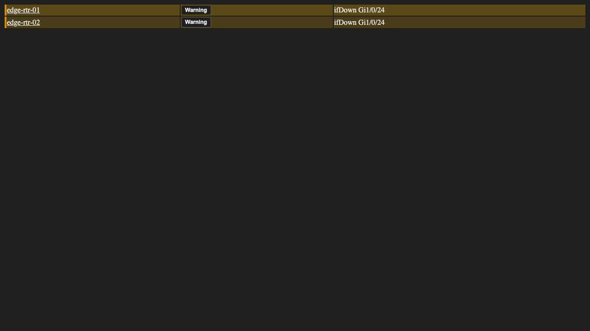

# syslog

The syslog plugin is a Cacti plugin that has been around for more than a decade.
It was inspired by the 'aloe' and 'h.aloe' plugins originally developed by the
Cacti users sidewinder and Harlequin in the early 2000's.  As you will be able
to see from the ChangeLog, it has undergone several changes throughout the
years, and remains, even today when you have enterprise offering from both
Elastic and Splunk, remains a relevant plugin for small to medium sized
companies.

It provides a simple Syslog event search an Alert generation and notification
interface that can generate both HTML and SMS messages for operations personnel
who wish to receive notifications inside of a data or network operations center.

When combined by the Linux SNMPTT package, it can be converted into an SNMP Trap
and Inform receiver and notification engine as the SNMPTT tool will receive SNMP
Traps and Informs and convert them into Syslog messages on your log server.
These syslog messages can then be consumed by the syslog plugin.  So, this tool
is quite handy.

For log events that continue to be generated frequently on a device, such as
smartd's feature to notify every 15 minutes of an impending drive failure, can
be quieted using syslog's 'Re-Alert' setting.

Threshold rules count matching messages within their rolling window. **Recover
After Quiet Period** defaults to 5 minutes: each match during an active breach
restarts that timer. A complete quiet period clears the breach, resets its count
to zero, and rearms it. The initial alert is sent once per breach; the existing
Re-Alert setting controls subsequent notifications while it remains active.

The **Breached Thresholds** tab appears when enabled threshold rules exist and
lists active breaches by rule and device, independently of notification history.

The Messages view shows **Breach = Yes** for messages associated with an active
breach and **No** after recovery. Grouped rows show Yes if any member is associated
with an active breach. Recovery updates indexed state and message associations,
without scanning or updating historical message rows. Existing historical flags
are not converted into active breaches. See [threshold recovery](docs/THRESHOLD_RECOVERY.md)
for lifecycle and deployment details.

## Core Features

* Message filtering

* Message searching

* Dashboards with time series and breakdown charts of your saved searches

* Share dashboards with all syslog users and manage every dashboard as an
  administrator

* Message Alerting

* Alert Reporting Levels of System and Device

* Alert Methods of Individual and Threshold Based

* Message Removal Rules that either Delete messages or Transfer them to the
  `syslog_removed` table

* Filter Messages by Cacti Graph window from Cacti's Graph View pages

* Use of native MySQL and MariaDB database partitioning for larger installs

* Remote Log Server connection capabilities

* Custom column mappings between Remote Log Server and required Syslog columns

* Ability to Generate Tickets to Ticketing Systems through Script Execution

* Ability to run alert specific commands at Alert and Re-alert times

## Pipeline Health Alerts

The Status tab includes a **Pipeline health** card in the existing Collector
health card position. It reports stalled processing, excessive or old incoming
backlogs, failed or delayed remote synchronization, and blocked partition
maintenance. An empty incoming queue is healthy when processing is completing;
quiet devices do not trigger source-silence alerts. Unavailable queue metrics
are reported as problems rather than healthy values.

Checks run from Cacti's poller before launching the Syslog processor, so a
stalled processor can still be detected. The delay is the greater of the
Collector Staleness Threshold, three poller intervals, and 300 seconds. New or
re-enabled monitoring gets a startup grace period. Incoming age uses the
configured incoming timestamp field; delayed historical events or incorrect
source clocks can therefore trigger an old-backlog warning.

In **Settings > Syslog**, select a **Pipeline Health Notification List** from
Thold and/or set **Pipeline Health Email Recipients** to enable problem,
changed-problem, reminder, and recovery emails using Cacti's mail settings.
Enabled lists add their current recipients on each check, preserving BCC
recipients; disabled or missing lists contribute no addresses. Direct email
recipients work without Thold. Email is disabled by default. Persistent problems repeat at the
configured reminder interval, and failed delivery attempts retry no more than
once every five minutes. The card shows the last health check, email attempt
status, and last successful send. Health state changes also appear in Cacti's
log. Intentionally disabled processing does not generate health notifications.

Monitoring requires a running Cacti poller and an accessible Syslog database.
Use external monitoring for a complete Cacti or database outage. Remote health
checks run on each enabled remote collector; this does not infer a collector
outage merely from a quiet stream of device messages.

## Table Architecture and Storage Engine Support

New installs always create partitioned `syslog` tables.  The traditional
non-partitioned table architecture is deprecated and can no longer be
selected during installation.  Existing installs that still run traditional
tables keep working and receive a notice advising an upgrade to partitioned
tables, but the plugin does not migrate the table automatically.

Only the InnoDB storage engine and, on MariaDB, the Aria storage engine are
supported.  Other engines, including MyISAM, are no longer offered and fall
back to InnoDB when legacy settings request them.  Enabling any Remote Data
Collector option requires InnoDB; the setup advisor selects it automatically.

## Important Version 4.0 Release Notes

In prior releases of Syslog, the Individual Alert Method would send an Email,
open a ticket or run a command per line in the Syslog that matches the pattern.
However, in Syslog Version 4, if you want an alert per Host, you will have to
move your Alerts from the `System` to the `Device` Reporting Level as `System`
level Alerts will generate one command execution for all matching messages.

## Develop Branch Compatibility and Hardening Notes

The following behavior is part of the hardening work being prepared on the
`develop` branch for the next release. Released versions may not include every
item yet.

### Runtime and Test Baseline

The plugin declares `compat = 1.2.23` in `INFO`, so it needs Cacti 1.2.23 or
later, and PHP 8.0 or later. Every non-test PHP file passes `php -l` on PHP 8.0
and 8.1. The Linux integration workflow runs PHP 8.2, 8.3, and 8.4 against the
Cacti `1.2.x` branch on MariaDB 11.8, including installation, plugin enablement,
polling, and sample Syslog processing. Other PHP, Cacti, and database versions
are not exercised by CI.

This plugin does not ship its own `composer.json`. Composer validation and
dependency installation in CI use the manifest supplied by the checked-out
Cacti core release.

### Security-Sensitive Behavior

* Purging unused Syslog hosts requires a POST request and a valid Cacti CSRF
  token. The operation fails closed when CSRF validation is unavailable.

* Alert, navigation, and JavaScript-bound values are escaped for their output
  context. JavaScript callback dispatch accepts only a bare function identifier
  with no arguments or dotted path.

* CSV exports continue to use PHP's `fputcsv()` for quoting. Cells beginning
  with spreadsheet formula markers (`=`, `+`, `-`, `@`, tab, or carriage
  return), including markers after leading spaces, are prefixed with a single
  quote before export.

* XML rule imports accept either pasted text or an uploaded file. Both paths
  enforce a 5 MiB payload limit before XML parsing; rejected payloads are logged
  and redirected without being parsed.

* Legacy SQL-expression rules remain trusted administrator configuration. Do
  not grant rule-management permissions to untrusted users, and review custom
  SQL expressions before enabling them.

### Incoming Transfer Recovery

Incoming transfers lock their processing slice and commit history, incoming
acknowledgement, and any remote outbox writes in one transaction. With InnoDB
history, a failed or disconnected transfer rolls back and can be retried.
Retries skip history identities already stored for the same collector, incoming
sequence, and event timestamp, while separate incoming events remain separate.

Aria history does not participate in transaction rollback. The identity check
prevents duplicate history on a transfer retry, but full atomic recovery across
a database or host crash requires InnoDB. Unarchived incoming rows are retained
regardless of their event age, including rows missing host or program references.

### Partition Maintenance

Partition retention uses actual upper boundaries against a UTC calendar cutoff,
with today counted as one retained day. A seven-day setting retains today plus
the previous six UTC dates, independently of partition count or the future
pre-create window. Fully expired partitions are dropped even after gaps in
maintenance. A partition spanning the cutoff is kept whole to protect newer
messages, so some older messages may remain until that partition fully expires.
Unknown boundaries or partition expressions stop pruning safely; indefinite
retention and the `dMaxValue` safety partition remain preserved.


Before each automatic reorganization, maintenance checks `dMaxValue` partition
statistics under its creation lock. Recovery stops if estimated occupancy exceeds
100,000 rows or 128 MiB of data plus indexes, or if size metadata is unavailable.
The Status tab and pipeline health report the deferral and request operator
intervention. The safety partition remains writable and retention pruning for
the affected table stays deferred. An operator must plan recovery outside the
poller; automatic recovery resumes when the overflow falls within these limits.
These checks contain large recovery operations but do not impose an ALTER
execution-time limit: statistics are estimates and concurrent writes can grow
overflow after the check.


Partition boundaries are calculated with integer UTC epoch arithmetic. When a
new partition cannot be created safely, maintenance leaves the `dMaxValue`
partition in place and skips retention pruning rather than risking a write gap.

### Validation

The repository includes a Pest test suite (`tests/Security`, `tests/Unit`)
run against Cacti's own Composer-managed vendor tree, plus a disposable
Docker/Playwright end-to-end harness. GitHub CI runs a single integration-test
workflow that checks out the Cacti `1.2.x` branch, runs the Pest suite, the
regression scripts, and the changed-line coverage check, and exercises the
syslog poller end-to-end on the PHP 8.2-8.4 matrix on Linux. The
Docker E2E runner refuses unsafe temporary-directory paths before performing
recursive cleanup.

## Installation

Requirements: Cacti 1.2.23 or later, PHP 8.0 or later, and MySQL or MariaDB
using InnoDB, or Aria on MariaDB (see the notes on SQL mode below).

To install the syslog plugin, copy the plugin directory to Cacti's plugins
directory and name it `syslog`. Then go to Cacti's Plugin Management page, and
Install and Enable the plugin, or run:

```shell
php cli/plugin_manage.php --plugin=syslog --install --enable --allperms
```

`--allperms` grants every syslog realm to the administrative accounts. Other
users need a realm assigned under Console > Users or User Groups:

| Realm | Grants |
| --- | --- |
| Syslog User | The Syslog tabs and message search |
| Rule Viewer | View the Alert, Removal, and Report rule pages |
| Rule Administrator | Edit rules, including device rules |
| Syslog Administration | Manage saved searches and dashboards |
| Share Saved Templates | Share saved searches with other users |
| Share Dashboards | Share dashboards with other users |

Installing creates the syslog tables (see Tables below). The installer shows the
Upgrade Advisor when it finds existing syslog tables. Its upgrade type is
`Truncate Syslog Table`, `Inline Upgrade`, or `Background Upgrade`; they only
change how a legacy non-partitioned `syslog` table is converted. An existing
partitioned install keeps its messages, rules, and hosts with each choice.

Note: You must rename config.php.dist in the syslog plugin directory to
config.php and make changes there for the location of the database, user,
password, and host.  This is especially important if you are using a remote
logging database server.

To upgrade, replace the plugin files and run the Upgrade Advisor from Plugin
Management, or check the schema with the CLI:

```shell
php plugins/syslog/cli/syslog_schema.php --audit
```

`--audit` reports missing tables without changing anything. `--repair` creates
missing tables and reruns schema migrations, and `--upgrade` also upgrades the
schema. Repair and upgrade keep existing data and preferences.

To uninstall, use Uninstall in Plugin Management and choose a method. `Remove
Everything` drops every syslog table, including rules and hosts; `Syslog Data
Only` drops the `syslog` and `syslog_removed` tables and keeps the rest. Neither
removes the `syslog_*` rows in Cacti's `settings` table. Either way the plugin
hooks and realms are removed.

You have two options for storing syslog information you can either use the existing
Cacti Database or use a dedicated database for syslog as syslog databases especially
for large networks can grow pretty quick it may be wise to create a dedicated database.
To use a dedicated DB, first create a database in MySQL or MariaDB and assign a
user. Then change

```console
$use_cacti_db = true;
```

to 

```console
$use_cacti_db = false;
```

Set the `$syslogdb_*` values below it to the new database and a user that can
create and write its tables; the shipped defaults are database `syslog` and user
`cactiuser` on `localhost`. The Cacti database user also needs read access:

```sql
GRANT SELECT ON syslog.* TO 'cactiuser'@'localhost';
```

Replace `cactiuser` with the account in Cacti's `config.php`. The tables are
created in the database named by `$syslogdb_default` when the plugin is enabled.

Remote collectors deliver records to the Main Collector's Syslog database.
By default, delivery uses the Main Collector Cacti connection and
`$database_default`. If the Main Collector stores Syslog in a different
database on that server, set `$syslog_replication_main_db_default` in the
remote collector's Syslog config file. If it uses a separate database server or
credentials, also set `$syslog_replication_main_db_hostname`, username,
password, and any required port or SSL options there.


### Cacti Configuration for RSYSLOG

Edit /etc/rsyslog.d/cacti.conf

```console
$ModLoad imudp
$UDPServerRun 514
$ModLoad ommysql

$template cacti_syslog,"INSERT INTO syslog_incoming(facility_id, priority_id, program, logtime, host, message) \
  values (%syslogfacility%, %syslogpriority%, '%programname%', '%timegenerated:::date-mysql%', '%HOSTNAME%', TRIM('%msg%'))", SQL

*.* >localhost,my_database,my_user,my_password;cacti_syslog
```

For version below 2.0 it should be:

```console
$ModLoad imudp
$UDPServerRun 514
$ModLoad ommysql

$template cacti_syslog,"INSERT INTO syslog_incoming(facility_id, priority_id, program, logtime, host, message)
values (%syslogfacility%, %syslogpriority%, '%programname%', '%timegenerated:::date-mysql%', '%HOSTNAME%', TRIM('%msg%'))", SQL

. >localhost,my_database,my_user,my_password;cacti_syslog
```

For version 2.4 and above it should be:

```console
module(load="ommysql")
action(type="ommysql" server="localhost" serverport="3306"
db="syslogDB" uid="userID" pwd="passwdID")

$template cacti_syslog,"INSERT INTO syslog_incoming(facility_id, priority_id, program, logtime, host, message)
values (%syslogfacility%, %syslogpriority%, '%programname%', '%timegenerated:::date-mysql%', '%HOSTNAME%', TRIM('%msg%'))", SQL
```

For CentOS/RHEL systems you will all need to install the rsyslog-mysql package

```
yum install rsyslog-mysql
systemctl restart rsyslog
```

If you are upgrading to version 2.5 from an earlier version, make sure that you
update this template format and restart rsyslog.  You may loose some syslog
data, but doing this in a timely fashion, will minimize data loss.

Ensure you restart rsyslog after these changes are completed.  Other logging
servers such as Syslog-NG are also supported with this plugin.  Please see some
additional documentation here: [Cacti Documentation
Site](https://docs.cacti.net/plugin:syslog.config)

We are using the pure integer values that rsyslog provides to both the priority
and facility in this version syslog, which makes the data collection must less
costly for the database.  We have also started including the 'program' syslog
column for searching and storage and alert generation.

To setup log forwarding from your network switches and routers, and from your
various Linux, UNIX, and other operating system devices, please see their
respective documentation.

Finally, it's important, especially in more recent versions of MySQL and MariaDB
to set a correct SQL Mode.  These more recent SQL's prevent certain previously
allowable syntax such as an empty data and certain group by limitations in the
SQL itself.  Therefore, you need to ensure that the SQL mode of the database is
correct.  To do this, first start by editing either `/etc/my.cnf` or
`/etc/my.cnf.d/server.cnf` and inserting the SQL mode variable into the database
configuration.  For example:

```ini
[mysqld]
sql_mode=NO_ENGINE_SUBSTITUTION,NO_AUTO_CREATE_USER
```

### Special Note for the Grouping feature
Syslog now supports the ability to group similar messages from a specific host together
for easy summarization for larger systems you may need to expand the default mariadb group_concat_max_len
The default is 1MB you may need to raise it much higher depending on your needs

After this change, you should log into the mysql server and run the following
command:

```console
mysql> show global variables like 'sql_mode';
```

And ensure that it matches the setting that you placed in the database
configuration.  If it does not, please search for the configuration that is
making this SQL mode other than what you required.  More recent versions of
MySQL and MariaDB will source multiple database configuration files.

## Tables

A completed install has 28 tables, all prefixed `syslog`: `syslog`,
`syslog_removed`, `syslog_incoming`, `syslog_logs`, `syslog_status`,
`syslog_hosts`, `syslog_programs`, `syslog_facilities`, `syslog_priorities`,
`syslog_host_facilities`, `syslog_alert`, `syslog_alert_counts`,
`syslog_alert_suppression`, `syslog_remove`, `syslog_reports`,
`syslog_device_rule`, `syslog_saved_searches`, `syslog_saved_searches_perm`,
`syslog_dashboards`, `syslog_dashboard_panels`, `syslog_dashboards_perm`,
`syslog_threshold_state`, `syslog_threshold_messages`,
`syslog_threshold_recovery_queue`, and the replication tables
`syslog_replication_collectors`, `syslog_replication_output`,
`syslog_replication_receipts`, and `syslog_replication_recovery`.

Senders write to `syslog_incoming`; the processor moves rows into `syslog`,
evaluates the rules, and records fired alerts in `syslog_logs`.

## Rules

* **Alert rules** have a Reporting Level of System or Device, a Reporting Method
  of Individual or Threshold, and a Match Type of Filter Builder or SQL
  Expression. SQL Expression is kept for legacy rules.
* **Removal rules** use a Method of Removal of Deletion or Transferal. Deletion
  discards the message; Transferal moves it to `syslog_removed`.
* **Report rules** send matching messages by email on a schedule.
* **Device rules** are managed from the Device Rules page and need the Rule
  Administrator realm.

## Settings

The settings are under Settings > Syslog. Selected names and defaults:

| Setting | Default |
| --- | --- |
| Syslog Enabled (`syslog_enabled`) | on |
| Refresh Interval (`syslog_refresh`) | 300 |
| Max Report Records (`syslog_maxrecords`) | 100 |
| Maximum Syslog Processing Processes (`syslog_max_workers`) | 1 |
| Enable Hostname Resolution (`syslog_resolve_hostname`) | off |
| Skip DNS Resolution for incoming hosts (`syslog_no_dns`) | off |
| Syslog Retention (`syslog_retention`) | 30 days |
| Syslog Alert Retention (`syslog_alert_retention`) | 30 days |
| Partition Pre-create Window (`syslog_partition_ahead_days`) | 3 days |
| Collector Staleness Threshold (`syslog_stale_threshold`) | 300 seconds |
| Collector Backlog Threshold (`syslog_backlog_threshold`) | 10000 rows |
| Pipeline Health Reminder Interval (`syslog_pipeline_health_repeat`) | 3600 seconds |

## Command Line

`syslog_process.php` runs from Cacti's poller. To run it by hand:

```shell
php plugins/syslog/syslog_process.php [--debug] [--force-report]
```

`--debug` prints verbose output and `--force-report` sends the email reports
now. `--help` and `--version` print usage and the plugin version. The options
`--child`, `--run-id`, `--phase`, `--seq-start`, and `--seq-end` are used by the
master process for its workers.

`cli/syslog_schema.php` takes `--audit`, `--repair`, or `--upgrade`, as
described under Installation.

## Development and Testing

The commands below are the ones the CI workflow runs, from the plugin directory
inside a Cacti `1.2.x` checkout with the plugin installed:

```shell
php tests/regression/cli_schema_upgrade_test.php
SYSLOG_TEST_MYSQL_DSN='mysql:host=127.0.0.1;port=3306' \
  SYSLOG_TEST_MYSQL_PASSWORD=<root password> \
  php tests/regression/threshold_recovery_database_test.php
php tests/bin/check-i18n-pot.php <base commit>
php tests/bin/patch-coverage.php coverage/clover.xml <base commit> 100
```

The same `SYSLOG_TEST_MYSQL_*` variables apply to
`quality_must_fix_database_test.php` and `incoming_preservation_database_test.php`.
The database tests need a MariaDB or MySQL account that can create databases.
The Pest suite is run from the Cacti directory with
`--configuration=plugins/syslog/phpunit.xml`, using the test dependencies
installed by the CI setup action. The Playwright scripts in `tests/browser` are
described in `tests/browser/README.md`; CI does not run them.

Translatable strings live in `locales/po/cacti.pot`; the CI i18n check fails a
pull request that changes translatable strings without updating it.

## Possible Bugs and Feature Enhancements

Bug and feature enhancements for the syslog plugin are handled in GitHub. If you
find a first search the Cacti forums for a solution before creating an issue in
GitHub.

## Authors

The syslog plugin has been in development for well over a decade with increasing
functionality and stibility over that time. There have been several contributors
to syslog over the years. Chief amongst them are Jimmy Conner, Larry Adams,
SideWinder, and Harlequin. We hope that version 2.0 and beyond are the most
stable and robust versions of syslog ever published. We are always looking for
new ideas. So, this won't be the last release of syslog, you can rest assured of
that.

## Building a message search

The message and triggered-alert viewers use a query builder. Choose a field,
operator, and value, then add **AND**, **OR**, or **NOT** conditions. For example:

```text
    Message contains  connection refused
AND Host    =         router-1
OR  Host    like      web-%
```

Fields include message, host, program, facility, priority, date, sequence, and
numeric IDs. Host ID is available in the system-log viewer. Text fields support
**contains**, **=**, **!=**, and **like**. Numeric IDs and dates support
**=**, **!=**, **>**, **>=**, **<**, and **<=**. Dates use `YYYY-MM-DD HH:MM:SS`.

Facility, priority, their IDs, and program ID use editable database-backed dropdowns.
ID choices show their names alongside the stored IDs. You can also enter a value
that is not yet in the database; ID fields still require nonnegative integers. Host, host ID, and program
text fields offer autocomplete. Message and sequence suggestions sample the
latest 1,000 records per selected record source; message suggestions start after
two characters. You can still type text or LIKE patterns. Dates keep their picker.

Contains treats wildcard and regex characters literally. LIKE uses `%` for any
number of characters and `_` for one character. Case sensitivity follows database
collation. AND takes precedence over OR; NOT excludes the
condition. Existing grouped expressions retain their grouping. Use **×** to
remove a condition, then Enter or Search to apply the query.

The standalone device, program, facility, and priority filters are replaced by
builder conditions. The only standalone dropdowns are Record Type, Display,
Results limit, Trim, and Refresh. From and To are Date conditions in the builder
(`>=` and `<=`), with the date/time picker available when their values are focused.
The current date range is migrated into these editable conditions. Removing them
removes the time restriction. Action buttons (Search, Clear, Refresh, Export, Save) appear below the collapsible search panel.
For rolling date ranges, select Date → In the last → Hour, 6 hours, Day, Week,
2 weeks, 30 days, 3 months, or 6 months. Month presets use calendar months. These ranges are recalculated by the database on each search or refresh.
Use the comparison operators for custom dates with the date picker.
Legacy regex searches become literal message contains conditions. Searches persist per tab across
pagination, refresh, grouping, and CSV export. The Refresh button reloads the current page of results without resetting the filter or pagination. Search, export, and clear
controls submit values through CSRF-protected POST bodies instead of URL queries.

A single blank default message condition clears the query. Other incomplete
conditions block submission. Searches allow up to 8192 bytes, 256 tokens, and 32
nesting levels. Invalid searches return no results and CSV export rejects them.

-----------------------------------------------
Copyright (c) 2004-2026 - The Cacti Group, Inc.

Optional [Alarm Manager forwarding](docs/ALARM_MANAGER.md) uses Cacti native in-process hooks with existing Syslog email as fallback.

## Result theme regression fixture



See [result theme tests](docs/RESULT_THEME_TESTS.md) for the populated light
fixture and browser reproduction command.
