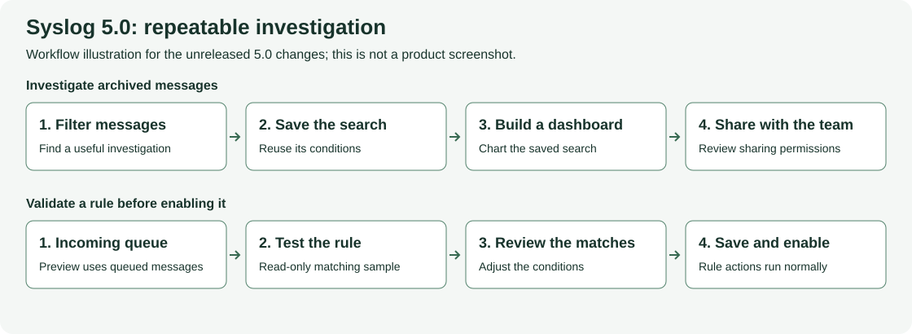

# Syslog 5.0: reusable investigations and clearer collector health

**Unreleased.** These notes describe the 5.0 changes on `develop`; the latest
published GitHub release is [4.2](https://github.com/Cacti/plugin_syslog/releases/tag/v4.2).

Syslog 5.0 brings saved searches, shared dashboards and grouped messages to
everyday log investigation. Preview alert and removal rules against queued
messages, view explanations for recognized message identifiers, and monitor
collection backlogs and processing delays from the Status page.

## Highlights

- **Reuse and share investigations.** Save named searches, collapse repeated
  messages into groups with occurrence counts, and build dashboards with time
  series and breakdown charts. Share searches and dashboards through the
  corresponding permission realms; recipients can make their own dashboard copy.
- **Preview a rule before enabling it.** The **Test rule** action returns a
  matching count and bounded message sample without saving the rule or performing
  its actions. It searches queued incoming messages, so an empty preview does not
  mean previously archived logs contain no matches.
- **See when collection needs attention.** Collector health shows the incoming
  backlog, oldest queued message, last received log and recent processing count.
  Phase timings and worker activity help locate delays; optional pipeline health
  notifications report problems and recovery. Complete Cacti or database outages
  still need external monitoring.
- **Give operators more context and control.** Recognized message identifiers can
  show an explanation and recommended action. Device Alert Rules support alert
  pauses and priority exceptions, while threshold alerts support recovery commands
  and the documented quiet-period recovery lifecycle.
- **Support remote collection and recovery.** Configured remote collectors keep
  processed events in a durable delivery queue through outages and retry delivery
  to the main collector. Parallel processing is configurable; partition recovery
  is bounded and reports blocked maintenance instead of silently pruning history.

The release also includes theme and message-readability improvements, security
hardening and fixes for installations using a separate Syslog database. See the
[full changelog](../CHANGELOG.md) for individual changes.

## Try the investigation workflow

For example, filter recurring interface-down messages, save the conditions, add a
chart based on that search and share the dashboard with the operations team.
Before enabling a new alert, use **Test rule** to inspect matching queued messages.
An empty queue preview does not search previously archived history.



## Upgrade decision guide

| Check | What to plan |
| --- | --- |
| Release status | 5.0 is unreleased. This page describes a fixed development snapshot, not the published 4.2 package. |
| Runtime | The documented floor is Cacti 1.2.23+ and PHP 8.0+; Cacti may require a newer PHP version. See the linked CI baseline. |
| Storage | InnoDB, or Aria on MariaDB; Remote Data Collector options require InnoDB. Existing traditional tables remain usable with a migration notice. |
| Ordinary upgrade | Preserve the database and local config. Existing timestamp precision stays unchanged. |
| Legacy table conversion | Review the Upgrade Advisor mode. For a legacy non-partitioned table, **Truncate Syslog Table** discards messages; existing partitioned installs retain their data with each advisor choice. |
| Optional timestamp conversion | MariaDB only. `cli/upgrade_partitioning.php --convert-ms` preserves stored messages by default; it is not needed for the new interface features. |

### Upgrade and verify before deployment

1. Back up the Syslog database and plugin/local configuration files together.
   Check the [runtime and test baseline](../README.md#runtime-and-test-baseline).
2. Follow the [upgrade instructions](../README.md#installation) and review the
   Upgrade Advisor choice before confirming it. Use a maintenance window for
   any table conversion; duration depends on the data and selected conversion.
3. Run the read-only schema audit from the Cacti directory:

   ```sh
   php plugins/syslog/cli/syslog_schema.php --audit
   ```

4. Confirm incoming messages reach the viewer, the processing backlog drains,
   and the Status page shows recent processing. Check each enabled remote
   collector as well as the main collector.
5. Test a representative saved search and queued-rule preview, review sharing
   realms, and confirm existing notifications still reach their intended recipients.

Also review [storage support](../README.md#table-architecture-and-storage-engine-support),
[threshold recovery](THRESHOLD_RECOVERY.md), and alert command paths. Command
templates now need absolute executable paths; the `/bin/sh` fallback is removed.
The Statistics tab and its collection are deprecated.

### Optional millisecond conversion

`cli/upgrade_partitioning.php --convert-ms` is MariaDB-only. It rebuilds
`syslog` and `syslog_removed` into replacement tables, copying stored messages
in verified batches, and widens `syslog_incoming` and the remote-delivery outbox
in place. Data is preserved by default; `--discard-data` deletes stored messages
instead. Legacy `DATETIME` `logtime` tables cannot be preserved automatically.
Rules and settings are preserved. Back up first and read the
[conversion instructions](../README.md#converting-an-existing-mariadb-install).
Normal upgrades never run this conversion automatically.

The earlier `cli/updatedb_convert_ms.php` utility has been replaced and is
removed on upgrade. It truncated the message tables and could fail on legacy
`TO_DAYS` partitioned tables with "Constant, random or timezone-dependent
expressions in (sub)partitioning function are not allowed".

If rollback is needed, restore plugin files and the database from the same
pre-upgrade backup; do not assume a binary-only downgrade reverses migrations.
Rehearse the checklist against a copy of your production configuration before
rollout.

## Contributors and change history

Thank you to the developers, translators, testers and reviewers who kept this
plugin moving forward. See the [linked contributor credits and selected commits](COMMITS_5.0.md).
Those links include the comparison, paginated history and original author records.

Development snapshot: [`2489d3d735`](https://github.com/Cacti/plugin_syslog/commit/2489d3d73555ac8b914e5768da55f1f15621b97c). Refresh and validate these notes when 5.0 is finalized.
