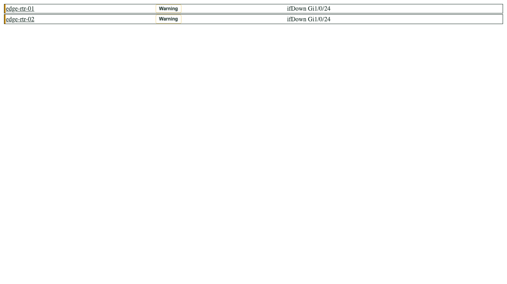

# Result theme regression checks

Result rows, links, and severity buttons use the foreground and card surface
sampled from the active Cacti theme. This keeps host selection colors from
replacing the foreground on a plugin-owned severity surface.




The screenshots contain two synthetic devices and interface-down messages.
They are browser component fixtures, not a running poller or database session.

Run with the existing Playwright dependency installed:

```sh
node tests/E2E/playwright/theme-contrast-check.cjs
```

Set `CHROMIUM_EXECUTABLE` to use an existing Chromium installation and
`THEME_TEST_OUTPUT` to choose the artifact directory (default
`tests/E2E/playwright/artifacts/theme-contrast`). The test checks light, dark, and muted dark palettes in resting,
hovered, selected, and selected-hovered rows. It also writes Chromium CSS
coverage to `changed-coverage.json`.

The Cacti theme compatibility suite additionally loads this plugin's real CSS
and theme-token JavaScript against all twelve host theme variants.
